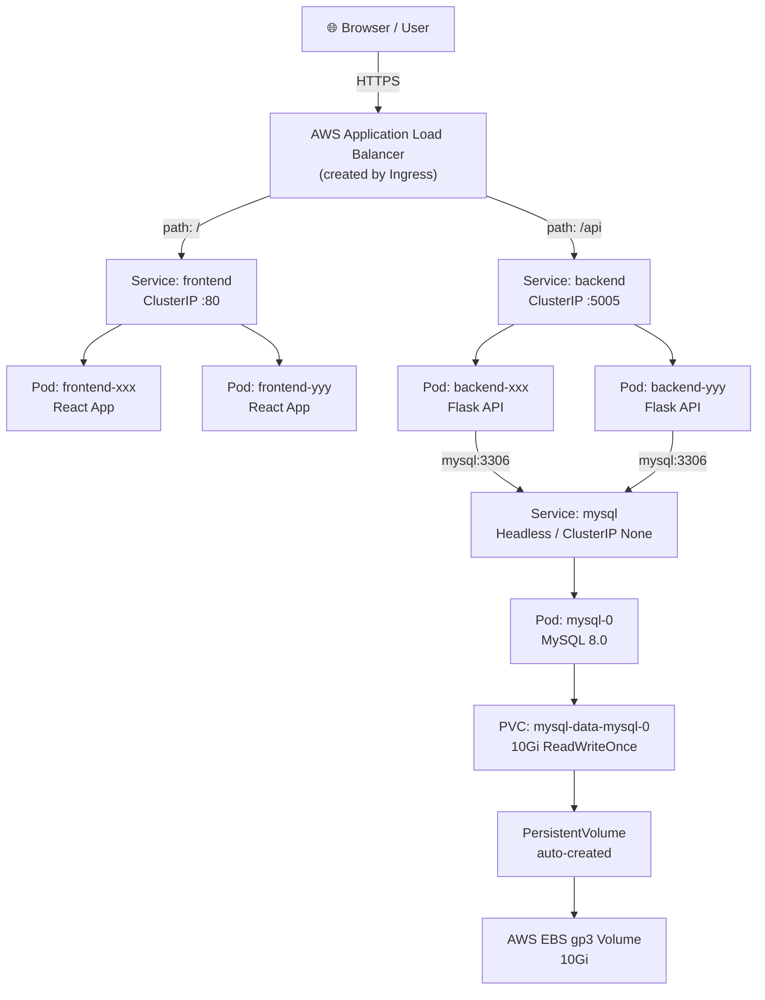
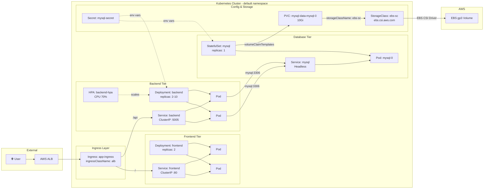
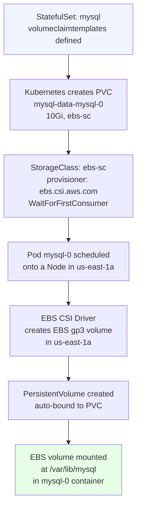
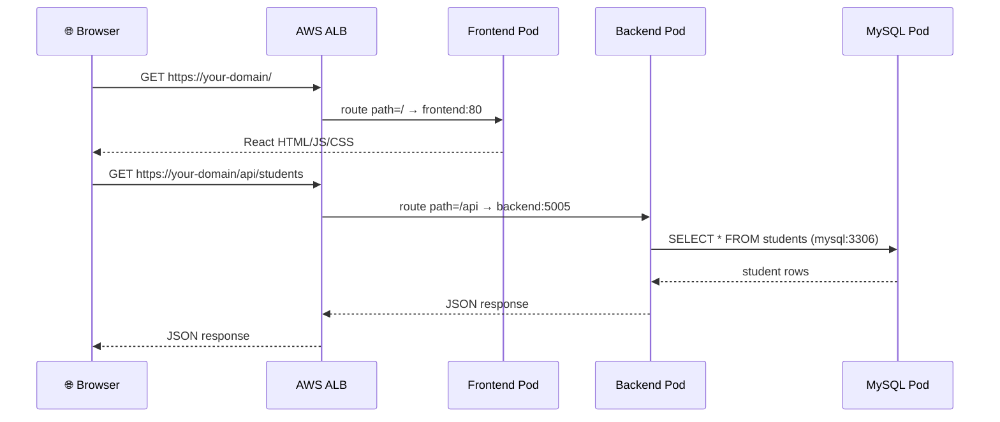
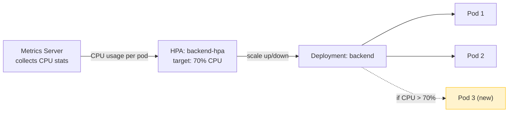
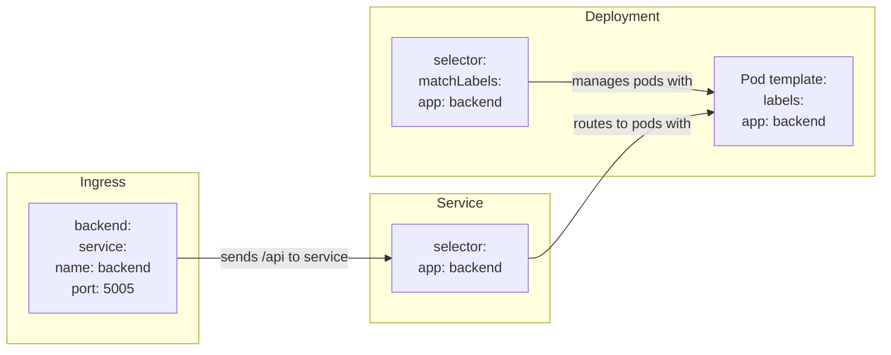
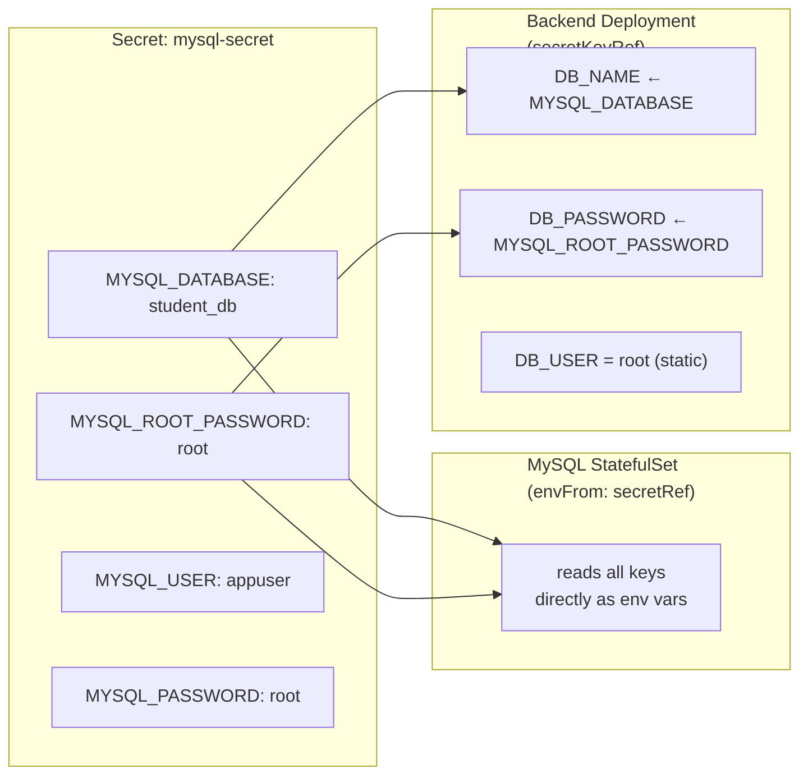

# Student App — Kubernetes on AWS EKS: Complete Implementation Guide

This guide walks you through every concept and every step needed to deploy the
Student Management Application on Amazon EKS. It is written for students who are
learning Kubernetes, so each section explains **why** before **how**.

---

## Table of Contents

1. [What Are We Building?](#1-what-are-we-building)
2. [Core Kubernetes Concepts You Must Know](#2-core-kubernetes-concepts-you-must-know)
3. [Full Architecture Diagram](#3-full-architecture-diagram)
4. [How All the Pieces Connect](#4-how-all-the-pieces-connect)
5. [File-by-File Explanation](#5-file-by-file-explanation)
6. [Storage Deep Dive — EBS Dynamic Provisioning](#6-storage-deep-dive--ebs-dynamic-provisioning)
7. [Networking Deep Dive — How a Request Travels](#7-networking-deep-dive--how-a-request-travels)
8. [Step-by-Step Deployment](#8-step-by-step-deployment)
9. [Verification Commands](#9-verification-commands)
10. [Troubleshooting Guide](#10-troubleshooting-guide)
11. [Key Rules and Why They Exist](#11-key-rules-and-why-they-exist)

---

## 1. What Are We Building?

A three-tier web application:

| Tier     | Technology          | Role                                      |
|----------|---------------------|-------------------------------------------|
| Frontend | React + Vite        | Browser UI served as static files         |
| Backend  | Python Flask        | REST API, business logic                  |
| Database | MySQL 8.0           | Persistent storage for student records    |

All three tiers run as containers inside **Amazon EKS** (Elastic Kubernetes Service).
Users access the app through a single **AWS Application Load Balancer (ALB)**,
which is created automatically by the **AWS Load Balancer Controller** when we
apply our Ingress manifest.

---

## 2. Core Kubernetes Concepts You Must Know

Before reading the architecture, understand these building blocks:

### Pod
The smallest unit in Kubernetes. A Pod wraps one or more containers that share
the same network and storage. You rarely create Pods directly — you use a
Deployment or StatefulSet to manage them.

### Deployment
Manages a set of identical, **stateless** Pods. It ensures the desired number of
replicas are always running. If a Pod crashes, the Deployment creates a new one.
Used for Frontend and Backend — they have no local state.

### StatefulSet
Like a Deployment, but for **stateful** workloads. Each Pod gets a stable name
(`mysql-0`, `mysql-1`) and its own persistent volume that follows it around.
Used for MySQL — data must survive Pod restarts.

### Service
A stable network endpoint (name + IP) that routes traffic to a set of Pods.
Pods come and go, but the Service name never changes. There are three types:
- **ClusterIP** — internal only, reachable inside the cluster
- **NodePort** — exposes on every node's IP (we do NOT use this)
- **LoadBalancer** — creates a cloud LB (we do NOT use this either)

### Ingress
Rules for routing external HTTP/HTTPS traffic into the cluster. It is NOT a
Service — it is a routing rule that a controller (AWS Load Balancer Controller)
reads and turns into a real AWS ALB.

### Secret
Stores sensitive data like passwords. Values are base64-encoded and injected into
Pods as environment variables. Keeps passwords out of your YAML files.

### StorageClass
Describes how to dynamically create persistent volumes (EBS in our case). You
define it once and then PVCs reference it.

### PersistentVolumeClaim (PVC)
A request for storage. "I need 10Gi of storage." Kubernetes uses the StorageClass
to fulfill that request by creating a real EBS volume automatically.

### HorizontalPodAutoscaler (HPA)
Watches CPU/memory usage and automatically adds or removes Pods to handle load.
Only applies to the stateless Backend in our app.

---

## 3. Full Architecture Diagram

### 3.1 High-Level Traffic Flow



### 3.2 Kubernetes Resource Map



### 3.3 Storage Provisioning Chain



### 3.4 Request Flow: Browser → MySQL



### 3.5 HPA Autoscaling Flow



---

## 4. How All the Pieces Connect

This is the most important thing to understand. Everything in Kubernetes is
connected through **labels and selectors**, not by direct reference.

### Label → Selector matching



The pattern is the same for all tiers:

| Resource           | Label on Pod     | Service Selector | Ingress Path |
|--------------------|------------------|------------------|--------------|
| frontend Deployment | `app: frontend` | `app: frontend`  | `/`          |
| backend Deployment  | `app: backend`  | `app: backend`   | `/api`       |
| mysql StatefulSet   | `app: mysql`    | `app: mysql`     | not exposed  |

### Secret key mapping



---

## 5. File-by-File Explanation

### `01-secret.yaml` — MySQL Credentials

**What it does:** Stores the MySQL root password, database name and user
credentials in a Kubernetes Secret. Both the MySQL StatefulSet and the Backend
Deployment read from this same Secret, so passwords are defined in exactly one
place.

**Why a Secret and not plain env vars?** Plain env vars in a YAML are visible to
anyone who reads the file or does `kubectl describe`. Secrets are stored encoded
and can be access-controlled with RBAC.

**Key points:**
- `stringData` accepts plain text — Kubernetes handles base64 encoding for you
- `MYSQL_ROOT_PASSWORD: root` is read by the MySQL container on first boot to
  set the root password, and by the Flask app to authenticate
- Replace `root` with a strong password before any real deployment

---

### `02-storageclass.yaml` — EBS Dynamic Provisioner

**What it does:** Defines a recipe for creating EBS volumes on demand. When
MySQL asks for storage via a PVC, this class instructs the EBS CSI Driver to
go to AWS and create a real disk.

**Why `WaitForFirstConsumer`?** EBS volumes are tied to a single Availability
Zone. If Kubernetes created the volume immediately (before knowing where the Pod
would run), the volume might end up in `us-east-1a` while the Pod lands on a
node in `us-east-1b`. That would cause a mount failure. `WaitForFirstConsumer`
delays the volume creation until the Pod is scheduled, so the volume is always
in the same AZ as the node.

**Why `gp3`?** It's the current-generation EBS type. It's cheaper than `gp2`
and lets you configure IOPS and throughput independently.

**Why `reclaimPolicy: Retain`?** If someone accidentally deletes the PVC, the
EBS volume and its data survive. You'd clean it up manually. This is the safe
default for databases.

---

### `03-mysql-service.yaml` — Headless Service for MySQL

**What it does:** Creates an internal Service named `mysql` that the Backend
uses as `DB_HOST=mysql`. The `clusterIP: None` makes it headless.

**Why headless (`clusterIP: None`)?** A normal Service has a virtual IP that
load-balances across Pods. StatefulSets don't want load balancing — they want
direct Pod DNS names like `mysql-0.mysql.default.svc.cluster.local`. Setting
`clusterIP: None` disables the virtual IP and enables per-Pod DNS records.

**Why is MySQL NOT in the Ingress?** MySQL is a TCP database, not an HTTP
service. The Ingress handles HTTP/HTTPS only. More importantly, exposing your
database to the internet would be a serious security risk.

---

### `04-mysql-statefulset.yaml` — MySQL Database

**What it does:** Runs one MySQL 8.0 Pod named `mysql-0` with a persistent
10Gi EBS volume mounted at `/var/lib/mysql`.

**Why StatefulSet and not Deployment?**
- A Deployment gives Pods random names. A StatefulSet gives stable names
  (`mysql-0`, `mysql-1`).
- A Deployment shares one volume across all Pods (or uses no volume). A
  StatefulSet creates a dedicated volume per Pod via `volumeClaimTemplates`.
- MySQL is not stateless — the data directory must survive restarts.

**Why `envFrom: secretRef`?** It injects ALL keys from `mysql-secret` as
environment variables at once. The `mysql:8.0` image reads `MYSQL_DATABASE`,
`MYSQL_ROOT_PASSWORD`, `MYSQL_USER`, and `MYSQL_PASSWORD` on first boot to
initialize the database.

**Health probes:** Both use `mysqladmin ping` which is the standard MySQL
health check. The liveness probe has a very long `initialDelaySeconds: 60`
to give MySQL time to initialize before Kubernetes considers killing it.

---

### `05-backend-deployment.yaml` — Flask API

**What it does:** Runs 2 Flask API Pods (the HPA adjusts this between 2-10).
Each Pod reads database credentials from the Secret and connects to MySQL.

**Why Deployment (not StatefulSet)?** Flask is stateless. Any Pod can handle
any request. There's no local data to persist. Deployments are the right choice
for stateless, horizontally scalable workloads.

**Why `DB_HOST=mysql`?** `mysql` is the name of the Kubernetes Service. Inside
the cluster, Kubernetes DNS resolves `mysql` to that Service's IP, which then
routes to the `mysql-0` Pod. This works because the Service's selector matches
the StatefulSet's Pod label (`app: mysql`).

**Why does DB_USER stay as plain `"root"` and not from the Secret?** The Flask
app's `init_db()` function runs `CREATE DATABASE IF NOT EXISTS` on startup.
This requires root privileges. The non-root `appuser` in the Secret doesn't
have those privileges. So we hardcode `DB_USER=root` and pull only the password
from the Secret.

**Why does the backend need CPU requests?** The HPA calculates CPU utilization
as: `(actual CPU used) / (CPU requested) × 100%`. If there's no CPU request,
the HPA can't compute a percentage and will refuse to scale. The 250m request
in the Deployment is the baseline the HPA uses.

---

### `06-backend-service.yaml` — Backend ClusterIP Service

**What it does:** Creates an internal Service named `backend` on port 5005.
The Ingress routes `/api` traffic here.

**Why ClusterIP and not LoadBalancer?** A LoadBalancer Service would create an
extra AWS NLB just for the backend. We already have one ALB created by the
Ingress. Using ClusterIP keeps the backend internal and all external traffic
goes through the single ALB, which also gives us unified logging, SSL
termination and path-based routing in one place.

---

### `07-backend-hpa.yaml` — Backend Autoscaler

**What it does:** Watches the backend Deployment's CPU usage. If the average
CPU across all backend Pods exceeds 70% of their requested CPU (250m), the HPA
adds more Pods. When usage drops, it removes Pods. Minimum 2, maximum 10.

**Why only the backend?**
- Frontend serves static files — CPU usage is negligible and predictable.
- MySQL cannot be horizontally scaled by adding Pods — each new Pod would get
  its own empty EBS volume and they'd have no data replication between them.
- Only the backend is CPU-intensive (Python, database queries) AND stateless
  (any Pod can handle any request).

**Prerequisite:** The Kubernetes Metrics Server must be running in the cluster
for HPA to work. On EKS you install it separately.

---

### `08-frontend-deployment.yaml` — React Frontend

**What it does:** Runs 2 Pods serving the built React/Vite static files via a
web server (Nginx inside the Docker image) on port 80.

**Why no HPA?** The frontend just serves pre-built static HTML/JS/CSS files.
There's almost no CPU involved. A fixed count of 2 replicas gives high
availability without needing autoscaling.

**Why no `VITE_API_URL` env var in the Deployment?** The Vite build bakes
`VITE_API_URL=/api` into the static files at **build time** (in the Dockerfile).
By the time the container runs, it's already compiled into the JavaScript. The
container itself doesn't need the variable at runtime.

**Why no imagePullSecrets?** The Docker Hub repositories are public. Kubernetes
can pull public images without authentication credentials.

---

### `09-frontend-service.yaml` — Frontend ClusterIP Service

**What it does:** Creates an internal Service named `frontend` on port 80.
The Ingress routes `/` traffic here.

Same reasoning as the backend Service — ClusterIP keeps it internal, the Ingress
is the single external entry point.

---

### `10-ingress.yaml` — ALB Ingress (Single Entry Point)

**What it does:** This is the most important file for external access. It creates
one AWS ALB with two routing rules:

```
https://YOUR-DOMAIN/      ->  frontend Service :80
https://YOUR-DOMAIN/api   ->  backend  Service :5005
```

**Why one Ingress and not two LoadBalancer Services?** One ALB = one entry
point, one SSL certificate, one DNS name, no CORS issues. Two LoadBalancer
Services would mean two separate AWS NLBs, two DNS names, and CORS problems
because the frontend and backend would be on different origins.

**Why is `/api` listed before `/`?** `pathType: Prefix` means `/` would match
EVERYTHING including `/api`. By listing `/api` first, the more specific rule
wins for API requests.

**Why no path rewrite?** The Flask app defines routes as `/api/students`,
`/api/health`, etc. If we rewrote `/api` to `/`, the browser would call
`/api/students` but Flask would receive `/students` — a 404. No rewrite means
Flask receives the path exactly as the browser sent it.

**Why no Nginx proxy?** The ALB handles path-based routing natively. Adding
Nginx would be an extra hop with no benefit and extra complexity to maintain.

---

## 6. Storage Deep Dive — EBS Dynamic Provisioning

This is often confusing for students. Here's the complete picture.

### What you write vs what Kubernetes creates automatically

```
You write                     Kubernetes creates automatically
─────────────────────────────────────────────────────────────
StorageClass (ebs-sc)    ──>  (nothing yet, just a recipe)
StatefulSet with
  volumeClaimTemplates   ──>  PVC: mysql-data-mysql-0
                         ──>  PV: pvc-<uuid>  (after scheduling)
                         ──>  EBS Volume: vol-<id>  (via CSI driver)
```

### Step-by-step what happens when you `kubectl apply`

1. You apply `04-mysql-statefulset.yaml`
2. Kubernetes sees `volumeClaimTemplates` and creates a PVC named
   `mysql-data-mysql-0` in the `default` namespace
3. The PVC references `storageClassName: ebs-sc`
4. Because `ebs-sc` has `volumeBindingMode: WaitForFirstConsumer`, the PVC
   stays in `Pending` state — no EBS volume yet
5. Kubernetes schedules the `mysql-0` Pod onto a node (say, in `us-east-1a`)
6. The EBS CSI Driver sees a Pod has been scheduled and the PVC is pending
7. It calls the AWS API to create a `gp3` EBS volume in `us-east-1a`
8. It creates a PersistentVolume object in Kubernetes bound to the PVC
9. The EBS volume is mounted into the `mysql-0` container at `/var/lib/mysql`
10. MySQL starts and initializes the database on the volume

### What persists across Pod restarts

If `mysql-0` crashes and Kubernetes restarts it:
- The Pod gets the same name `mysql-0`
- Kubernetes re-attaches the same PVC `mysql-data-mysql-0`
- Which is bound to the same PV and the same EBS volume
- MySQL starts and finds all data intact

This is the entire reason for using a StatefulSet over a Deployment.

---

## 7. Networking Deep Dive — How a Request Travels

### DNS inside the cluster

Every Service gets a DNS name automatically:
```
<service-name>.<namespace>.svc.cluster.local
```

Short form (within the same namespace):
```
mysql          ->  mysql.default.svc.cluster.local
backend        ->  backend.default.svc.cluster.local
frontend       ->  frontend.default.svc.cluster.local
```

So when the Flask app does `DB_HOST=mysql`, it actually resolves to
`mysql.default.svc.cluster.local` automatically.

For the headless mysql Service, each Pod also gets its own DNS:
```
mysql-0.mysql.default.svc.cluster.local
```

### Full request path: user fetching student list

```
Browser
  │
  │  GET https://abc.us-east-1.elb.amazonaws.com/api/students
  ▼
AWS ALB
  │  path matches /api  →  Target Group: backend pods (direct pod IP)
  │  target-type: ip means ALB routes to Pod IPs, not Service IPs
  ▼
backend Pod (e.g. 192.168.1.50:5005)
  │
  │  mysql.default.svc.cluster.local:3306  (resolves via kube-dns)
  ▼
mysql Service  (headless, selects mysql-0)
  ▼
mysql-0 Pod (192.168.2.10:3306)
  │
  │  reads from /var/lib/mysql
  ▼
EBS gp3 volume
```

### Why `target-type: ip` matters on EKS

Without `target-type: ip`, the ALB would route to NodePort (a port on the EC2
instance) and kube-proxy would then forward to the Pod. With `target-type: ip`,
the ALB skips the node and sends traffic directly to the Pod IP. This is faster,
gives the backend the real client IP, and works correctly with ClusterIP Services.

---

## 8. Step-by-Step Deployment

### Prerequisites checklist

Before running any `kubectl` command, verify these are in place:

```bash
# 1. kubectl is configured for your EKS cluster
kubectl get nodes

# 2. AWS Load Balancer Controller is installed
kubectl get deployment -n kube-system aws-load-balancer-controller

# 3. Amazon EBS CSI Driver is installed
kubectl get daemonset -n kube-system ebs-csi-node

# 4. Metrics Server is installed (needed for HPA)
kubectl get deployment -n kube-system metrics-server
```

### Step 1 — Edit the Secret with real passwords

Open `k8s/01-secret.yaml` and replace the passwords:

```yaml
stringData:
  MYSQL_DATABASE: student_db
  MYSQL_USER: appuser
  MYSQL_PASSWORD: YourStrongPassword123!      # change this
  MYSQL_ROOT_PASSWORD: YourRootPassword456!   # change this
```

> The backend connects as root, so `MYSQL_ROOT_PASSWORD` is the one that
> matters for the app. Make it strong.

### Step 2 — Edit Docker image names

In `k8s/05-backend-deployment.yaml`:
```yaml
image: chinmay2301/cbz-backend:latest
```

In `k8s/08-frontend-deployment.yaml`:
```yaml
image: chinmay2301/cbz-frontend:latest
```

Update these to your actual Docker Hub images if they differ.

### Step 3 — Apply all manifests

Apply in order. The numbered filenames ensure `kubectl apply -f k8s/` applies
them in the right sequence (StorageClass before StatefulSet, Secret before
Deployment, etc.)

```bash
kubectl apply -f k8s/
```

Or apply individually to watch each step:

```bash
kubectl apply -f k8s/01-secret.yaml
kubectl apply -f k8s/02-storageclass.yaml
kubectl apply -f k8s/03-mysql-service.yaml
kubectl apply -f k8s/04-mysql-statefulset.yaml
kubectl apply -f k8s/05-backend-deployment.yaml
kubectl apply -f k8s/06-backend-service.yaml
kubectl apply -f k8s/07-backend-hpa.yaml
kubectl apply -f k8s/08-frontend-deployment.yaml
kubectl apply -f k8s/09-frontend-service.yaml
kubectl apply -f k8s/10-ingress.yaml
```

### Step 4 — Wait for MySQL to be ready

MySQL takes the longest because the EBS volume needs to be provisioned first:

```bash
# Watch the PVC go from Pending -> Bound
kubectl get pvc -w

# Watch the mysql-0 pod go from Pending -> Running
kubectl get pods -w -l app=mysql
```

Expected final state:
```
NAME                    STATUS   VOLUME           CAPACITY
mysql-data-mysql-0      Bound    pvc-<uuid>       10Gi
```

### Step 5 — Wait for all Pods to be Running

```bash
kubectl get pods
```

Expected output:
```
NAME                        READY   STATUS    RESTARTS
backend-<hash>              1/1     Running   0
backend-<hash>              1/1     Running   0
frontend-<hash>             1/1     Running   0
frontend-<hash>             1/1     Running   0
mysql-0                     1/1     Running   0
```

### Step 6 — Get the ALB DNS name

```bash
kubectl get ingress app-ingress
```

Expected output:
```
NAME          CLASS   HOSTS   ADDRESS                                          PORTS
app-ingress   alb     *       k8s-default-appingr-<id>.us-east-1.elb.amazonaws.com   80
```

The `ADDRESS` field is your ALB DNS name. It takes 2-3 minutes to provision
after you apply the Ingress.

### Step 7 — Test the application

```bash
# Replace with your actual ALB DNS
ALB="k8s-default-appingr-<id>.us-east-1.elb.amazonaws.com"

# Test backend health
curl http://$ALB/api/health

# Test student list
curl http://$ALB/api/students

# Open frontend in browser
echo "Open: http://$ALB"
```

---

## 9. Verification Commands

```bash
# ── Overview ──────────────────────────────────────────────────────────────────
kubectl get all
kubectl get pvc
kubectl get pv
kubectl get ingress
kubectl get hpa
kubectl get storageclass ebs-sc

# ── Pods ──────────────────────────────────────────────────────────────────────
# List all pods with their node placement
kubectl get pods -o wide

# Watch pod status in real time
kubectl get pods -w

# ── Ingress / ALB ─────────────────────────────────────────────────────────────
kubectl get ingress app-ingress
kubectl describe ingress app-ingress   # shows ALB ARN, target groups, rules

# ── HPA ───────────────────────────────────────────────────────────────────────
kubectl get hpa backend-hpa
kubectl describe hpa backend-hpa       # shows current vs target CPU, events

# ── Storage ───────────────────────────────────────────────────────────────────
kubectl get pvc                        # should show Bound
kubectl get pv                         # should show the auto-created volume
kubectl describe pvc mysql-data-mysql-0

# ── Services ──────────────────────────────────────────────────────────────────
kubectl get svc
kubectl describe svc mysql             # verify Endpoints points to mysql-0 IP
kubectl describe svc backend
kubectl describe svc frontend
```

---

## 10. Troubleshooting Guide

### Pod is stuck in `Pending`

```bash
kubectl describe pod <pod-name>
```
Look at the `Events` section at the bottom.

Common reasons:
- **Insufficient resources:** Node doesn't have enough CPU/memory. Check
  `kubectl describe node <node-name>` for allocatable resources.
- **PVC Pending:** For mysql-0, the PVC must become Bound before the Pod starts.
  Check `kubectl describe pvc mysql-data-mysql-0`.

---

### Pod is in `CrashLoopBackOff`

```bash
# Read the container logs
kubectl logs <pod-name>

# Read logs from a previous (crashed) instance
kubectl logs <pod-name> --previous
```

Common reasons for backend:
- **DB_PASSWORD wrong:** Flask can't connect to MySQL. Check the Secret values
  and make sure `MYSQL_ROOT_PASSWORD` matches what MySQL was initialized with.
- **MySQL not ready yet:** Flask tries to connect before MySQL finishes booting.
  The `initialDelaySeconds: 10` readiness probe helps, but watch logs with
  `kubectl logs -f <backend-pod>`.

Common reasons for MySQL:
- **Wrong MYSQL_ROOT_PASSWORD:** If the EBS volume already has MySQL data from
  a previous run, the password in the Secret must match. If you changed the
  password and the volume has old data, you'd need to delete the PVC and let it
  re-initialize.

---

### PVC stuck in `Pending`

```bash
kubectl describe pvc mysql-data-mysql-0
```

Common reasons:
- **EBS CSI Driver not installed.** Check:
  `kubectl get pods -n kube-system | grep ebs-csi`
- **WaitForFirstConsumer:** The PVC stays Pending until mysql-0 is scheduled.
  This is normal. The PVC becomes Bound once the Pod is running.
- **IAM permissions:** The EBS CSI Driver needs IAM permissions to create EBS
  volumes. This is an AWS setup issue, not a Kubernetes YAML issue.

---

### Ingress ADDRESS is empty

```bash
kubectl describe ingress app-ingress
```

Common reasons:
- **AWS Load Balancer Controller not installed.** Without it, nothing reads the
  Ingress rules and creates the ALB. Check:
  `kubectl get pods -n kube-system | grep aws-load-balancer`
- **IAM permissions missing:** The controller needs AWS permissions to create
  ALBs. This is a cluster setup issue.
- **Wait 2-3 minutes:** ALB provisioning takes time after the Ingress is applied.

---

### HPA shows `<unknown>` for CPU

```bash
kubectl describe hpa backend-hpa
```

If you see `unable to get metrics` or `<unknown>/70%`:
- **Metrics Server not installed.** The HPA cannot work without it. Check:
  `kubectl get deployment -n kube-system metrics-server`
- **No CPU requests:** The backend Deployment must have `resources.requests.cpu`
  set (it does — 250m). If you removed it, the HPA can't compute utilization.

---

### Backend can't connect to MySQL

```bash
# Check the backend environment variables are set correctly
kubectl exec -it <backend-pod> -- env | grep DB

# Try connecting manually from inside the backend pod
kubectl exec -it <backend-pod> -- bash
# Inside the pod:
# curl mysql:3306  (won't give HTTP but TCP connect shows if port is reachable)
```

Check that:
- `DB_HOST=mysql` (the Service name, not the Pod name or container name)
- The mysql Service selector matches the StatefulSet Pod label
- mysql-0 is Running and its readiness probe is passing

```bash
kubectl get endpoints mysql   # should show an IP, not <none>
```

---

## 11. Key Rules and Why They Exist

| Rule | Why |
|------|-----|
| Frontend and Backend use ClusterIP Services | Prevents direct external access; all external traffic must go through the Ingress/ALB, giving you a single point for SSL, logging and routing |
| MySQL uses a headless Service | StatefulSets need stable per-Pod DNS names; `clusterIP: None` enables this |
| MySQL is NOT in the Ingress | Databases are TCP, not HTTP; exposing them to the internet is a security risk |
| No NodePort anywhere | NodePort exposes a port on every node's public IP — bypasses the ALB and breaks the architecture |
| One Ingress, one ALB | One entry point = one SSL cert, one domain, no CORS, unified logs |
| /api is NOT rewritten | Flask routes are already prefixed with /api; rewriting would cause 404s |
| No Nginx proxy | The ALB handles path routing natively; Nginx would add complexity with no benefit |
| No imagePullSecrets | Docker Hub images are public; secrets are only needed for private registries |
| StatefulSet for MySQL | Persistent, ordered, stable identity storage — not possible with a Deployment |
| Deployment for Frontend/Backend | Stateless Pods that can be replaced freely and scaled horizontally |
| HPA only on Backend | Frontend is trivially cheap (static files); MySQL can't be horizontally scaled this way |
| WaitForFirstConsumer | Ensures EBS volume is created in the same AZ as the Pod |
| reclaimPolicy: Retain | Protects database data from accidental PVC deletion |
| CPU requests on Backend | Required for HPA to compute utilization percentages |
| /api before / in Ingress | Prefix matching: without ordering, / would match API requests first |
